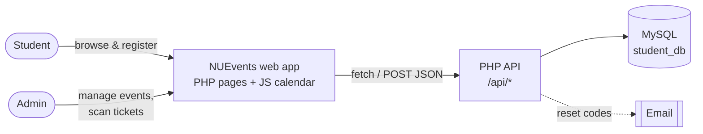
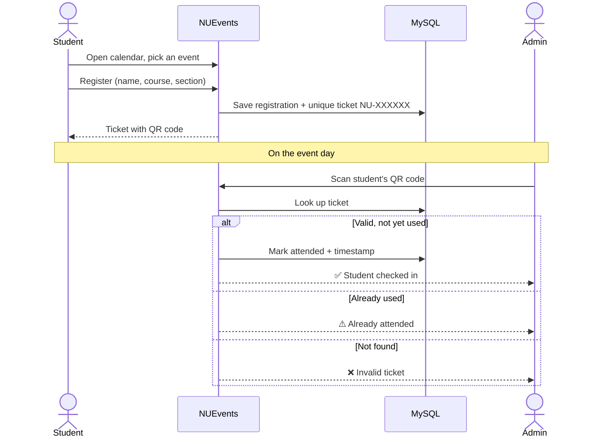
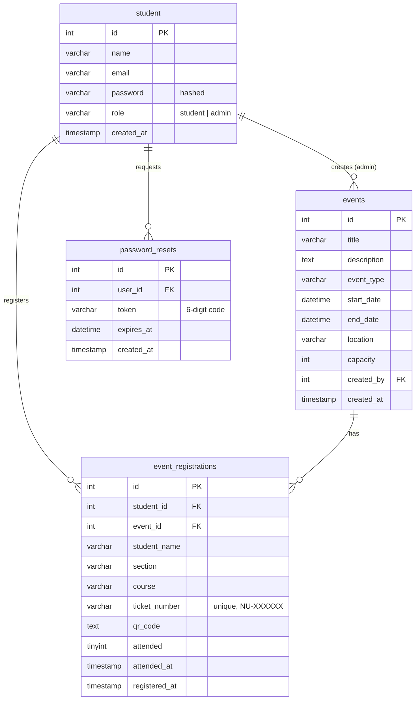

# NUEvents: Event Calendar System

A campus event calendar for **National University – Laguna**. Admins publish seminars, workshops and other events on a shared calendar; students register in a few clicks and get a **ticket with a QR code**; at the venue, admins **scan the QR code** to verify the ticket and record attendance.


---

## Contents

- [Why we built it](#why-we-built-it)
- [Features](#features)
- [How it works](#how-it-works)
- [Screens](#screens)
- [Tech stack](#tech-stack)
- [Database](#database)
- [Project structure](#project-structure)
- [API endpoints](#api-endpoints)
- [Getting started](#getting-started)
- [Team](#team)

---

## Why we built it

Campus events were announced in scattered places, students had no single view of what was coming up, and attendance was taken by hand on paper lists. NUEvents puts every event on one calendar, turns each registration into a verifiable ticket, and makes taking attendance as fast as scanning a code.

## Features

### For students
- **Event calendar**: browse upcoming events by month and open any event for its details (type, date and time, location, description)
- **One-step registration**: register with name, course and section
- **QR ticket**: every registration produces a unique ticket number (`NU-XXXXXX`) and a QR code that can be shown on a phone at the venue
- **My registered events**: view all of your tickets in one place
- **Profile page** and account menu

### For admins
- **Event management**: create, edit and delete events with type (Events, Seminars, Webinar, Workshop), start and end time, location and capacity
- **Admin calendar view** of everything that's scheduled, plus a university-calendar sync action
- **QR attendance scanner**: scan a student's ticket with the device camera (or type the ticket number) to verify it and mark them present; tickets that were already used are flagged
- **Attendance records**: see who registered and who actually attended, with timestamps

### Accounts and security
- **NU Laguna emails only**: sign-up accepts official university addresses, and the role is assigned automatically from the domain
  - `@students.nu-laguna.edu.ph` → **student**
  - `@nu-laguna.edu.ph` → **admin**
- Passwords are hashed with PHP's `password_hash` / `password_verify`
- **Forgot password**: a 6-digit code is emailed to the user and expires after **15 minutes**, with a resend option
- Session-based access control; admin-only endpoints reject non-admin sessions
- Database queries use prepared statements

## How it works

### System overview



### From registration to attendance



### Account flow

```mermaid
flowchart TD
    R[Sign up with email] --> D{Email domain?}
    D -->|@students.nu-laguna.edu.ph| ST[Student account]
    D -->|@nu-laguna.edu.ph| AD[Admin account]
    D -->|anything else| X[Rejected]
    ST --> L[Log in]
    AD --> L
    L --> SD[Student dashboard & calendar]
    L --> AH[Admin dashboard, calendar & attendance]
    F[Forgot password] --> C[6-digit code by email<br/>valid 15 minutes] --> V[Verify code] --> P[Set new password] --> L
```

## Screens

| Area | Pages |
| --- | --- |
| Auth | Login / Register, Forgot password, Verify code, Reset password |
| Student | Dashboard, Calendar, View ticket, Profile |
| Admin | Dashboard, Calendar, Edit event, Delete event, Attendance (QR scanner), Profile |
| Shared | View events |

<!--
Screenshots: save images in docs/screenshots/ and uncomment.

| Login | Student calendar |
| --- | --- |
|  |  |

| QR ticket | Admin attendance scanner |
| --- | --- |
|  |  |
-->

## Tech stack

| Layer | Technology |
| --- | --- |
| Frontend | HTML, CSS, vanilla JavaScript (custom calendar), Font Awesome |
| QR codes | [QRCode.js](https://github.com/davidshimjs/qrcodejs) to generate tickets, [html5-qrcode](https://github.com/mebjas/html5-qrcode) to scan with the camera |
| Backend | PHP (sessions, `mysqli` prepared statements, JSON API endpoints) |
| Database | MySQL / MariaDB |
| Email | PHP `mail()` (password reset codes) |
| Local server | XAMPP (Apache + MySQL) |

## Database



## Project structure

```
webprog/
├── index.php                     # Login / register page (entry point)
├── includes/
│   ├── config.php                # Database connection
│   └── profile_menu_popup.php    # Shared account menu
├── pages/
│   ├── auth/                     # login_register, forgot_password, verify_code, reset_password
│   ├── student/                  # dashboard, calendar, view_ticket, profile
│   ├── admin/                    # dashboard, calendar, attendance, edit/delete event, profile
│   └── shared/                   # view_events
├── api/
│   ├── auth/                     # logout, resend_code, verify_code_handler, reset_passwordhandler
│   ├── events/                   # add, edit, delete, get events, university calendar sync
│   ├── registration/             # register_event, get_registered_events, get_registration_info
│   └── attendance/               # verify_ticket, mark_attendance
├── assets/
│   ├── css/                      # style, student, calendar_admin
│   ├── js/                       # script, calendar_functions, calendar_admin
│   └── images/
└── sql/
    ├── student_db.sql            # Full schema
    └── update_database_attendance.sql   # Migration for older databases
```

## API endpoints

All endpoints live under `/api` and return JSON.

| Area | Endpoint | What it does |
| --- | --- | --- |
| Events | `events/get_events.php` | List events for the calendar |
| | `events/add_event.php` | Create an event *(admin)* |
| | `events/edit_event.php` | Update an event *(admin)* |
| | `events/delete_event.php` | Delete an event *(admin)* |
| | `events/update_university_calendar.php` | Sync the university calendar *(admin)* |
| Registration | `registration/register_event.php` | Register for an event and issue a ticket |
| | `registration/get_registered_events.php` | The current student's registrations |
| | `registration/get_registration_info.php` | Ticket details for one registration |
| Attendance | `attendance/verify_ticket.php` | Look up a ticket number and check whether it was used *(admin)* |
| | `attendance/mark_attendance.php` | Mark a ticket as attended *(admin)* |
| Auth | `auth/verify_code_handler.php` | Check a password reset code |
| | `auth/resend_code.php` | Send a new reset code |
| | `auth/reset_passwordhandler.php` | Save the new password |
| | `auth/logout.php` | End the session |

## Getting started

### Requirements
- [XAMPP](https://www.apachefriends.org/) (Apache + PHP + MySQL/MariaDB)
- A modern browser; camera access is needed for the QR scanner

### Setup

1. **Clone into XAMPP's web folder**
   ```bash
   cd C:/xampp/htdocs
   git clone https://github.com/kyleparas47-beep/webprog.git
   ```
2. **Start Apache and MySQL** from the XAMPP Control Panel.
3. **Create the database**: open <http://localhost/phpmyadmin>, create a database named `student_db`, then import `sql/student_db.sql`.
   *(Only if you're upgrading an older copy of the database: also run `sql/update_database_attendance.sql`.)*
4. **Check the connection settings** in `includes/config.php` (default XAMPP: user `root`, empty password, database `student_db`).
5. **Open the app** at <http://localhost/webprog/>.
6. **Create accounts**: register with an `@students.nu-laguna.edu.ph` address for a student account and an `@nu-laguna.edu.ph` address for an admin account.

### Email (password reset)
Reset codes are sent with PHP's `mail()`, which needs a mail server configured in XAMPP (`php.ini` / `sendmail.ini`). For local testing without email, the code is also written to the PHP error log (`xampp/php/logs/php_error_log`).

> **Tip:** the QR scanner needs camera access. Browsers allow it on `localhost`; when deployed, serve the site over HTTPS.

## Team

Built by a team of 5 for a web programming course at National University – Laguna (2025).

- **Kyle Justine Paras**: Team lead · Full-stack developer · UI design

## License

Developed for academic purposes.
